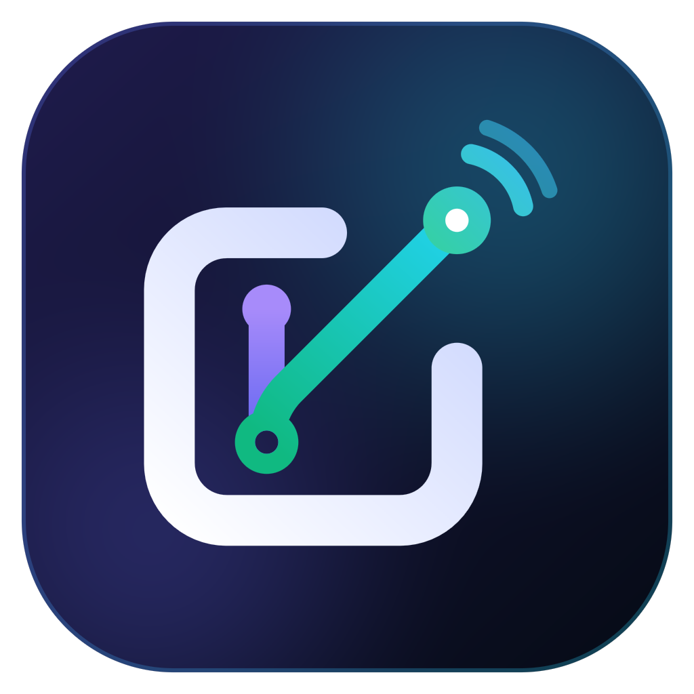

<div align="center">

<br>

<a href="https://github.com/novislab/vsl">
  
</a>

<br><br>

<picture>
  <source media="(prefers-color-scheme: dark)" srcset="art/vsl-mark.png">
  <source media="(prefers-color-scheme: light)" srcset="art/vsl-mark-light.png">
  
</picture>

<h3>Zero-wait Git worktree HTTPS previews for Laravel, FrankenPHP Octane, Bun + Vite HMR, Caddy &amp; T3 Code.</h3>

<p>
  <a href="https://www.php.net/"></a>
  <a href="https://laravel-zero.com/"></a>
  <a href="https://caddyserver.com/"></a>
  <a href="tests/"></a>
</p>

<p>
  <a href="#-quick-install">Quick Install</a> •
  <a href="#-how-it-works">How It Works</a> •
  <a href="#-commands">Commands</a> •
  <a href="#-t3-code--server-setup">T3 Code &amp; Server Setup</a> •
  <a href="#-arm64-static-binary-spc">ARM64 Binary</a> •
  <a href="#-brand--art-assets">Brand Assets</a>
</p>

</div>

---

## ⚡ Why `vsl`?

When **T3 Code** spins up a new Git worktree, you shouldn't wait minutes for `composer install`, `npm install`, manual Nginx/Caddy edits, database creation, or `php artisan octane:reload`.

`vsl` hydrates the worktree, boots **Octane + `bun dev` (Vite WSS HMR) + isolated database migrations** in parallel, wires **automatic Let's Encrypt HTTPS** via `sslip.io`, and prints a **scannable terminal QR code**—all in **~300–600ms**.

---

## 📦 Quick Install

Install `vsl` globally to `/usr/local/bin/vsl` and run it from anywhere:

```bash
curl -fsSL https://raw.githubusercontent.com/novislab/vsl/main/install.sh | bash
```

Install `vsl` **and** enable `systemd` reboot persistence (`vsl-resurrect.service` + `caddy.service`):

```bash
curl -fsSL https://raw.githubusercontent.com/novislab/vsl/main/install.sh | VSL_WITH_SERVICE=1 bash
```

Verify from any directory:

```bash
vsl --version
vsl list
```

<details>
<summary>Custom installer options (<code>VSL_REPO</code>, <code>VSL_BRANCH</code>, <code>VSL_INSTALL_DIR</code>)</summary>

```bash
VSL_REPO=novislab/vsl VSL_BRANCH=main VSL_INSTALL_DIR=/usr/local/bin VSL_WITH_SERVICE=1 \
  curl -fsSL https://raw.githubusercontent.com/novislab/vsl/main/install.sh | bash
```

</details>

---

## 🔄 How It Works

```text
  T3 Code Worktree Hook (post-create)
                 │
                 ▼
            ┌─────────┐
            │ vsl up  │  1. Single `git rev-parse` worktree + slug discovery
            └────┬────┘  2. EC2 IMDSv2 / cached IPv4 ──▶ https://<slug>.<ip>.sslip.io
                 │       3. Parallel `Process::pool()`:
                 │            • `cp -al vendor` & `node_modules` (0 extra disk)
                 │            • `cp -a storage` (isolated per worktree)
                 │            • `.env` rewrite (`APP_URL` + isolated `DB_DATABASE`)
                 ├──────────────────────────┬──────────────────────────┐
                 ▼                          ▼                          ▼
        Octane (FrankenPHP)          Bun + Vite HMR             DB Background Job
        127.0.0.1:9100–9900          127.0.0.1:5173–5899        `db:provision` (setsid)
        • `--watch` (chokidar)       • Untracked wrapper in     • MySQL / Postgres / SQLite
        • or `--max-requests=1`        `~/.vsl/vite/`           • `CREATE DATABASE`
        (zero manual reload)         • `wss://` HMR over :443   • `migrate --force --seed`
                 │                          │
                 └────────────┬─────────────┘
                              ▼
                  Caddy Admin API (:2019)
                  • Auto Let's Encrypt TLS on :443
                  • Proxies `/@vite/*` + `vite-hmr` WS ──▶ Vite
                  • Proxies app routes                 ──▶ Octane
                              │
                              ▼
            ~/.vsl/state.json (flock LOCK_EX) + Terminal QR Code
```

---

## 🛠 Commands

### `vsl up` — Spin up a worktree preview

```bash
vsl up
```

Options:

```bash
vsl up [--path=/path/to/worktree] [--no-qr] [--no-db] [--no-seed] [--no-vite] [--prod] [--json]
```

| Flag | Description |
| --- | --- |
| `--path=` | Target worktree path (defaults to current directory) |
| `--no-qr` | Skip printing the terminal Unicode half-block QR code |
| `--no-db` | Skip `.env` DB isolation and background DB provisioning |
| `--no-seed` | Run `php artisan migrate --force` without `--seed` |
| `--no-vite` | Skip launching `bun dev` / Vite HMR proxy |
| `--prod` | Disable dev auto-reload flags (`--watch` / `--max-requests=1`) |
| `--json` | Machine-readable JSON output (hook-safe, suppresses Prompts UI) |

---

### `vsl down` — Tear down a preview (keeps worktree on disk)

Stops Octane, `bun dev`, and any in-flight DB job, cleans `public/hot`, deletes the Caddy route, removes the entry from `~/.vsl/state.json`, and drops the isolated database in the background.

```bash
vsl down
```

Target a specific slug, branch, or path (or omit in an interactive TTY to pick from a `Laravel\Prompts\select()` menu):

```bash
vsl down feat-auth
vsl down --path=/path/to/worktree
vsl down feat-auth --keep-db
```

---

### `vsl list` — Show active previews & worker health

Checks live process status (`RUNNING` / `DEAD`) for Octane and Vite, and prunes dead entries with `--prune`:

```bash
vsl list
vsl list --prune
vsl list --json
```

---

### `vsl resurrect` — Restore previews after an EC2 reboot

Prunes deleted worktree directories, restarts dead Octane and Vite workers, and re-registers Caddy HTTPS routes:

```bash
vsl resurrect
vsl resurrect --json
```

---

### `vsl install-service` — Enable `systemd` auto-resurrect on boot

Installs `/etc/systemd/system/vsl-resurrect.service` (`After=network-online.target caddy.service`) and enables both `caddy.service` and `vsl-resurrect.service`:

```bash
vsl install-service
vsl install-service --user=ubuntu --binary=/usr/local/bin/vsl
vsl install-service --dry-run
```

---

## 🧩 T3 Code & Server Setup

### 1. Caddy Bootstrap (`/etc/caddy/Caddyfile`)

```bash
sudo cp deploy/Caddyfile /etc/caddy/Caddyfile
sudo systemctl enable --now caddy
```

Contents of [`deploy/Caddyfile`](deploy/Caddyfile):

```caddyfile
{
	admin localhost:2019
}
```

### 2. T3 Code Worktree Lifecycle Hooks

Add [`deploy/t3-hooks.json`](deploy/t3-hooks.json) to your T3 Code configuration:

```json
{
  "worktree": {
    "hooks": {
      "post-create": "/usr/local/bin/vsl up --path=\"$WORKTREE_PATH\"",
      "post-remove": "/usr/local/bin/vsl down --path=\"$WORKTREE_PATH\""
    }
  }
}
```

### 3. Environment Variables

| Variable | Default | Purpose |
| --- | --- | --- |
| `VSL_HOME` | `~/.vsl` | Base directory for `state.json`, `config.json`, `vite/`, and `logs/` |
| `VSL_PUBLIC_IP` | EC2 IMDSv2 / cached | Override public IPv4 for `sslip.io` domain generation |
| `VSL_CADDY_ADMIN` | `http://127.0.0.1:2019` | Caddy Admin API endpoint |

---

## 🏗 ARM64 Static Binary (`spc`)

Compile a single self-contained static ELF binary for AWS EC2 Ubuntu `linux-arm64` (`aarch64`) using **Manticore / `static-php-cli` (`spc`)**:

```bash
./build-arm64.sh
```

This builds `builds/vsl` PHAR, compiles PHP 8.3 `micro` SAPI (`pcntl,posix,curl,openssl,mbstring,tokenizer,ctype,filter,json,sockets,phar,zlib`), combines into `./dist/vsl-linux-arm64`, installs to `/usr/local/bin/vsl`, and runs `/usr/local/bin/vsl install-service`.

---

## 🎨 Brand & Art Assets

<div align="center">

| Asset | Preview | File |
| --- | :---: | --- |
| **App Icon** |  | [`art/vsl-icon.png`](art/vsl-icon.png) · [`art/vsl-icon.svg`](art/vsl-icon.svg) |
| **Dark Mark** |  | [`art/vsl-mark.png`](art/vsl-mark.png) · [`art/vsl-mark.svg`](art/vsl-mark.svg) |
| **Light Mark** |  | [`art/vsl-mark-light.png`](art/vsl-mark-light.png) · [`art/vsl-mark-light.svg`](art/vsl-mark-light.svg) |
| **Hero Lockup** |  | [`art/vsl-lockup.svg`](art/vsl-lockup.svg) |

</div>

Regenerate all SVG and 1024×1024 PNG renders with the zero-dependency analytical SDF generator:

```bash
python3 art/generate_logo.py
```

---

## 📁 Project Structure

```text
app/
├── Commands/
│   ├── Concerns/InteractsWithVslUi.php   # hrtime() timer & hook-safe Prompts UI
│   ├── DbProvisionCommand.php             # Background `db:provision` worker
│   ├── DbTeardownCommand.php              # Background `db:teardown` worker
│   ├── DownCommand.php                    # `vsl down`
│   ├── InstallServiceCommand.php          # `vsl install-service`
│   ├── ListCommand.php                    # `vsl list`
│   ├── ResurrectCommand.php               # `vsl resurrect`
│   ├── SummaryCommand.php                 # Default `vsl` command summary
│   └── UpCommand.php                      # `vsl up`
├── Data/
│   ├── WorktreeInfo.php                   # Git worktree discovery DTO
│   └── WorktreeState.php                  # Persisted state DTO
├── Services/
│   ├── CaddyClient.php                    # Caddy Admin API (:2019) + Vite HMR routes
│   ├── DatabaseManager.php                # .env DB scanner + detached migrate/seed/drop
│   ├── GitInspector.php                   # Single-call git rev-parse + RFC 1123 slug
│   ├── IpResolver.php                     # VSL_PUBLIC_IP / cache / EC2 IMDSv2
│   ├── OctaneManager.php                  # Port allocator, detached FrankenPHP, --watch
│   ├── StateStore.php                     # flock(LOCK_EX) atomic state.json
│   ├── ViteManager.php                    # vite.config.* wrapper + detached bun dev
│   └── WorkspaceHydrator.php              # Parallel cp -al / cp -a + .env APP_URL
└── Support/
    ├── HalfBlockQrOutput.php              # Unicode half-block terminal QR renderer
    └── VslPaths.php                       # ~/.vsl path resolver
```

---

## 🧪 Running Tests

```bash
composer install
./vendor/bin/pest
```

```bash
./vendor/bin/pint --test
```
